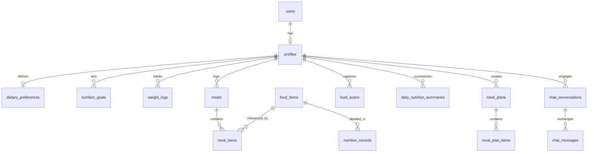

# DATABASE SCHEMA DOCUMENTATION
## Context-Aware AI Food and Nutrition Assistant
**Database Engine**: PostgreSQL 15+ (Hosted on Supabase)

---

## 1. Entity-Relationship Overview



---

## 2. Table Specifications & DDL Scripts

### 2.1 profiles
Stores biological biometrics and fundamental health metrics.
```sql
CREATE TABLE public.profiles (
    id UUID PRIMARY KEY REFERENCES auth.users(id) ON DELETE CASCADE,
    email TEXT NOT NULL,
    full_name TEXT,
    avatar_url TEXT,
    age INT CHECK (age > 0 AND age < 130),
    gender TEXT CHECK (gender IN ('male', 'female', 'other')),
    height_cm NUMERIC(5, 2) CHECK (height_cm > 40 AND height_cm < 280),
    weight_kg NUMERIC(5, 2) CHECK (weight_kg > 20 AND weight_kg < 400),
    activity_level TEXT CHECK (activity_level IN ('sedentary', 'lightly_active', 'moderately_active', 'very_active', 'extra_active')) DEFAULT 'sedentary',
    bmr NUMERIC(7, 2),
    tdee NUMERIC(7, 2),
    target_calories NUMERIC(7, 2),
    target_protein_g NUMERIC(6, 2),
    target_carbs_g NUMERIC(6, 2),
    target_fat_g NUMERIC(6, 2),
    target_fiber_g NUMERIC(6, 2),
    onboarding_completed BOOLEAN DEFAULT FALSE,
    created_at TIMESTAMPTZ DEFAULT NOW(),
    updated_at TIMESTAMPTZ DEFAULT NOW()
);
```

### 2.2 dietary_preferences
Stores allergy profiles, cuisine choices, and dietary patterns.
```sql
CREATE TABLE public.dietary_preferences (
    id UUID PRIMARY KEY DEFAULT gen_random_uuid(),
    user_id UUID NOT NULL REFERENCES public.profiles(id) ON DELETE CASCADE UNIQUE,
    dietary_type TEXT CHECK (dietary_type IN ('omnivore', 'vegetarian', 'vegan', 'eggetarian', 'pescatarian', 'keto', 'low_carb')) DEFAULT 'omnivore',
    allergies TEXT[] DEFAULT ARRAY[]::TEXT[],
    intolerances TEXT[] DEFAULT ARRAY[]::TEXT[],
    preferred_cuisines TEXT[] DEFAULT ARRAY['Indian']::TEXT[],
    disliked_foods TEXT[] DEFAULT ARRAY[]::TEXT[],
    meal_frequency INT DEFAULT 3 CHECK (meal_frequency BETWEEN 1 AND 8),
    health_conditions TEXT[] DEFAULT ARRAY[]::TEXT[],
    created_at TIMESTAMPTZ DEFAULT NOW(),
    updated_at TIMESTAMPTZ DEFAULT NOW()
);
```

### 2.3 food_items
Standardized catalog of food items across Indian (ICMR-NIN IFCT), USDA, and Open Food Facts sources.
```sql
CREATE TABLE public.food_items (
    id UUID PRIMARY KEY DEFAULT gen_random_uuid(),
    name TEXT NOT NULL,
    category TEXT,
    serving_unit TEXT DEFAULT 'g',
    standard_serving_g NUMERIC(6, 2) DEFAULT 100.0,
    source TEXT CHECK (source IN ('ICMR_NIN', 'USDA', 'OPEN_FOOD_FACTS', 'CUSTOM', 'AI_ESTIMATED')) NOT NULL,
    source_id TEXT,
    is_verified BOOLEAN DEFAULT TRUE,
    created_at TIMESTAMPTZ DEFAULT NOW()
);

CREATE INDEX idx_food_items_name ON public.food_items USING gin(to_tsvector('english', name));
```

### 2.4 nutrition_records
Nutrient density per 100g serving for food items.
```sql
CREATE TABLE public.nutrition_records (
    id UUID PRIMARY KEY DEFAULT gen_random_uuid(),
    food_item_id UUID NOT NULL REFERENCES public.food_items(id) ON DELETE CASCADE UNIQUE,
    calories NUMERIC(7, 2) NOT NULL,
    protein_g NUMERIC(6, 2) DEFAULT 0,
    carbs_g NUMERIC(6, 2) DEFAULT 0,
    fat_g NUMERIC(6, 2) DEFAULT 0,
    fiber_g NUMERIC(6, 2) DEFAULT 0,
    sugar_g NUMERIC(6, 2) DEFAULT 0,
    sodium_mg NUMERIC(7, 2) DEFAULT 0,
    potassium_mg NUMERIC(7, 2) DEFAULT 0,
    calcium_mg NUMERIC(7, 2) DEFAULT 0,
    iron_mg NUMERIC(7, 2) DEFAULT 0,
    vitamin_c_mg NUMERIC(7, 2) DEFAULT 0,
    updated_at TIMESTAMPTZ DEFAULT NOW()
);
```

### 2.5 meals
Logs meal sessions (Breakfast, Lunch, Dinner, Snack) per user per date.
```sql
CREATE TABLE public.meals (
    id UUID PRIMARY KEY DEFAULT gen_random_uuid(),
    user_id UUID NOT NULL REFERENCES public.profiles(id) ON DELETE CASCADE,
    meal_type TEXT CHECK (meal_type IN ('breakfast', 'lunch', 'dinner', 'snack')) NOT NULL,
    logged_date DATE NOT NULL DEFAULT CURRENT_DATE,
    logged_time TIME NOT NULL DEFAULT CURRENT_TIME,
    notes TEXT,
    total_calories NUMERIC(7, 2) DEFAULT 0,
    total_protein_g NUMERIC(6, 2) DEFAULT 0,
    total_carbs_g NUMERIC(6, 2) DEFAULT 0,
    total_fat_g NUMERIC(6, 2) DEFAULT 0,
    total_fiber_g NUMERIC(6, 2) DEFAULT 0,
    created_at TIMESTAMPTZ DEFAULT NOW()
);

CREATE INDEX idx_meals_user_date ON public.meals(user_id, logged_date);
```

### 2.6 meal_items
Line-item ingredients or dishes within a logged meal.
```sql
CREATE TABLE public.meal_items (
    id UUID PRIMARY KEY DEFAULT gen_random_uuid(),
    meal_id UUID NOT NULL REFERENCES public.meals(id) ON DELETE CASCADE,
    food_item_id UUID REFERENCES public.food_items(id) ON DELETE SET NULL,
    food_name TEXT NOT NULL,
    serving_weight_g NUMERIC(6, 2) NOT NULL,
    calories NUMERIC(7, 2) NOT NULL,
    protein_g NUMERIC(6, 2) DEFAULT 0,
    carbs_g NUMERIC(6, 2) DEFAULT 0,
    fat_g NUMERIC(6, 2) DEFAULT 0,
    fiber_g NUMERIC(6, 2) DEFAULT 0,
    created_at TIMESTAMPTZ DEFAULT NOW()
);
```

### 2.7 food_scans
Records multimodal AI scans and verification statuses.
```sql
CREATE TABLE public.food_scans (
    id UUID PRIMARY KEY DEFAULT gen_random_uuid(),
    user_id UUID NOT NULL REFERENCES public.profiles(id) ON DELETE CASCADE,
    image_url TEXT,
    detected_food_name TEXT NOT NULL,
    confidence_score NUMERIC(4, 3),
    alternative_candidates JSONB DEFAULT '[]'::JSONB,
    detected_ingredients TEXT[] DEFAULT ARRAY[]::TEXT[],
    estimated_serving_g NUMERIC(6, 2),
    confirmed_food_name TEXT,
    confirmed_serving_g NUMERIC(6, 2),
    is_confirmed BOOLEAN DEFAULT FALSE,
    nutrition_calculated JSONB,
    created_at TIMESTAMPTZ DEFAULT NOW()
);
```

### 2.8 daily_nutrition_summaries
Aggregated daily totals for rapid analytics and chart rendering.
```sql
CREATE TABLE public.daily_nutrition_summaries (
    id UUID PRIMARY KEY DEFAULT gen_random_uuid(),
    user_id UUID NOT NULL REFERENCES public.profiles(id) ON DELETE CASCADE,
    summary_date DATE NOT NULL,
    consumed_calories NUMERIC(7, 2) DEFAULT 0,
    target_calories NUMERIC(7, 2) DEFAULT 2000,
    consumed_protein_g NUMERIC(6, 2) DEFAULT 0,
    target_protein_g NUMERIC(6, 2) DEFAULT 120,
    consumed_carbs_g NUMERIC(6, 2) DEFAULT 0,
    target_carbs_g NUMERIC(6, 2) DEFAULT 250,
    consumed_fat_g NUMERIC(6, 2) DEFAULT 0,
    target_fat_g NUMERIC(6, 2) DEFAULT 65,
    consumed_fiber_g NUMERIC(6, 2) DEFAULT 0,
    target_fiber_g NUMERIC(6, 2) DEFAULT 30,
    water_intake_ml NUMERIC(6, 1) DEFAULT 0,
    created_at TIMESTAMPTZ DEFAULT NOW(),
    UNIQUE(user_id, summary_date)
);
```

### 2.9 nutrition_goals
Historical and active fitness/dietary goals.
```sql
CREATE TABLE public.nutrition_goals (
    id UUID PRIMARY KEY DEFAULT gen_random_uuid(),
    user_id UUID NOT NULL REFERENCES public.profiles(id) ON DELETE CASCADE,
    goal_type TEXT CHECK (goal_type IN ('weight_loss', 'weight_gain', 'maintenance', 'muscle_building', 'general_health')) NOT NULL,
    target_weight_kg NUMERIC(5, 2),
    target_date DATE,
    calorie_adjustment INT DEFAULT 0,
    is_active BOOLEAN DEFAULT TRUE,
    created_at TIMESTAMPTZ DEFAULT NOW()
);
```

### 2.10 weight_logs
Biometric progression tracking.
```sql
CREATE TABLE public.weight_logs (
    id UUID PRIMARY KEY DEFAULT gen_random_uuid(),
    user_id UUID NOT NULL REFERENCES public.profiles(id) ON DELETE CASCADE,
    weight_kg NUMERIC(5, 2) NOT NULL,
    logged_date DATE NOT NULL DEFAULT CURRENT_DATE,
    notes TEXT,
    created_at TIMESTAMPTZ DEFAULT NOW()
);
```

### 2.11 meal_plans & 2.12 meal_plan_items
AI-recommended structured meal schedules.
```sql
CREATE TABLE public.meal_plans (
    id UUID PRIMARY KEY DEFAULT gen_random_uuid(),
    user_id UUID NOT NULL REFERENCES public.profiles(id) ON DELETE CASCADE,
    plan_name TEXT NOT NULL,
    plan_type TEXT CHECK (plan_type IN ('daily', 'weekly')) DEFAULT 'daily',
    start_date DATE NOT NULL,
    end_date DATE,
    total_target_calories NUMERIC(7, 2),
    is_active BOOLEAN DEFAULT TRUE,
    created_at TIMESTAMPTZ DEFAULT NOW()
);

CREATE TABLE public.meal_plan_items (
    id UUID PRIMARY KEY DEFAULT gen_random_uuid(),
    meal_plan_id UUID NOT NULL REFERENCES public.meal_plans(id) ON DELETE CASCADE,
    day_of_week INT CHECK (day_of_week BETWEEN 0 AND 6),
    meal_type TEXT CHECK (meal_type IN ('breakfast', 'lunch', 'dinner', 'snack')) NOT NULL,
    suggested_food_name TEXT NOT NULL,
    serving_weight_g NUMERIC(6, 2),
    estimated_calories NUMERIC(7, 2),
    protein_g NUMERIC(6, 2),
    carbs_g NUMERIC(6, 2),
    fat_g NUMERIC(6, 2),
    rationale TEXT
);
```

### 2.13 chat_conversations & 2.14 chat_messages
Contextual AI nutritionist chat sessions.
```sql
CREATE TABLE public.chat_conversations (
    id UUID PRIMARY KEY DEFAULT gen_random_uuid(),
    user_id UUID NOT NULL REFERENCES public.profiles(id) ON DELETE CASCADE,
    title TEXT DEFAULT 'Nutrition Discussion',
    created_at TIMESTAMPTZ DEFAULT NOW(),
    updated_at TIMESTAMPTZ DEFAULT NOW()
);

CREATE TABLE public.chat_messages (
    id UUID PRIMARY KEY DEFAULT gen_random_uuid(),
    conversation_id UUID NOT NULL REFERENCES public.chat_conversations(id) ON DELETE CASCADE,
    sender_role TEXT CHECK (sender_role IN ('user', 'assistant', 'system')) NOT NULL,
    content TEXT NOT NULL,
    context_snapshot JSONB,
    created_at TIMESTAMPTZ DEFAULT NOW()
);
```

---

## 3. Row Level Security (RLS) Policies
Each user table is strictly isolated:
```sql
ALTER TABLE public.profiles ENABLE ROW LEVEL SECURITY;
CREATE POLICY "Users can access own profile" ON public.profiles FOR ALL USING (auth.uid() = id);

ALTER TABLE public.dietary_preferences ENABLE ROW LEVEL SECURITY;
CREATE POLICY "Users can access own preferences" ON public.dietary_preferences FOR ALL USING (auth.uid() = user_id);

ALTER TABLE public.meals ENABLE ROW LEVEL SECURITY;
CREATE POLICY "Users can access own meals" ON public.meals FOR ALL USING (auth.uid() = user_id);

ALTER TABLE public.meal_items ENABLE ROW LEVEL SECURITY;
CREATE POLICY "Users can access own meal items" ON public.meal_items FOR ALL USING (
    EXISTS (SELECT 1 FROM public.meals WHERE meals.id = meal_items.meal_id AND meals.user_id = auth.uid())
);

ALTER TABLE public.food_scans ENABLE ROW LEVEL SECURITY;
CREATE POLICY "Users can access own scans" ON public.food_scans FOR ALL USING (auth.uid() = user_id);

ALTER TABLE public.daily_nutrition_summaries ENABLE ROW LEVEL SECURITY;
CREATE POLICY "Users can access own daily summaries" ON public.daily_nutrition_summaries FOR ALL USING (auth.uid() = user_id);

ALTER TABLE public.nutrition_goals ENABLE ROW LEVEL SECURITY;
CREATE POLICY "Users can access own goals" ON public.nutrition_goals FOR ALL USING (auth.uid() = user_id);

ALTER TABLE public.weight_logs ENABLE ROW LEVEL SECURITY;
CREATE POLICY "Users can access own weights" ON public.weight_logs FOR ALL USING (auth.uid() = user_id);

ALTER TABLE public.meal_plans ENABLE ROW LEVEL SECURITY;
CREATE POLICY "Users can access own meal plans" ON public.meal_plans FOR ALL USING (auth.uid() = user_id);

ALTER TABLE public.chat_conversations ENABLE ROW LEVEL SECURITY;
CREATE POLICY "Users can access own conversations" ON public.chat_conversations FOR ALL USING (auth.uid() = user_id);

ALTER TABLE public.chat_messages ENABLE ROW LEVEL SECURITY;
CREATE POLICY "Users can access own messages" ON public.chat_messages FOR ALL USING (
    EXISTS (SELECT 1 FROM public.chat_conversations WHERE chat_conversations.id = chat_messages.conversation_id AND chat_conversations.user_id = auth.uid())
);

-- Public readable reference table
ALTER TABLE public.food_items ENABLE ROW LEVEL SECURITY;
CREATE POLICY "Anyone can read food items" ON public.food_items FOR SELECT USING (true);
CREATE POLICY "Users can insert custom food items" ON public.food_items FOR INSERT WITH CHECK (auth.uid() IS NOT NULL);

ALTER TABLE public.nutrition_records ENABLE ROW LEVEL SECURITY;
CREATE POLICY "Anyone can read nutrition records" ON public.nutrition_records FOR SELECT USING (true);
```
